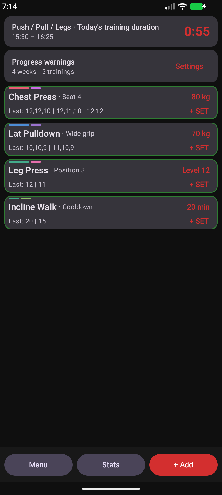
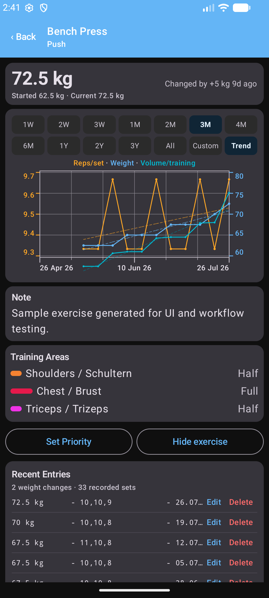
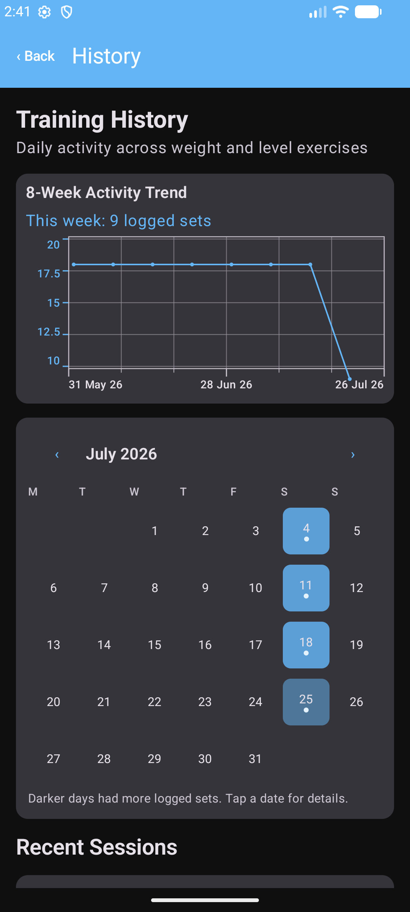
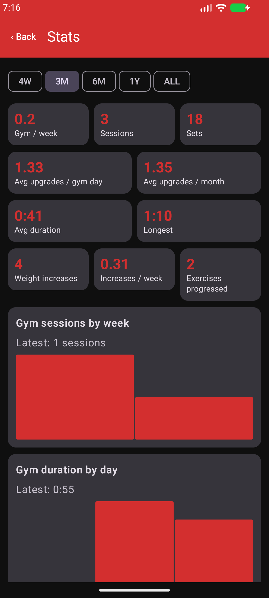

<p align="center">
  
</p>

<h1 align="center">GymLog</h1>

<p align="center">
  A private, offline-first workout and body-metrics tracker for Android.
</p>

<p align="center">
  <a href="https://github.com/FlorianLindinger/GymLog/actions/workflows/verify.yml"></a>
  <a href="https://github.com/FlorianLindinger/GymLog/releases/latest"></a>
  <a href="LICENSE"></a>
  
</p>

## Features

- Weight-, level-, and duration-based workout logging
- Multiple independent training plans
- Flexible manual and automatic exercise ordering
- Editable history, progression warnings, and live-training status
- Interval charts with gridlines, rolling averages, linear fits, and targets
- Body trends for weight, body fat, and lean body mass
- Per-plot body targets and independent Y-axis limits, with compact automatic scaling
- Optional, permission-controlled Health Connect synchronization
- Portable JSON backup and restore
- Download and load individual training-plan files without replacing existing plans
- Add weight with optional body-fat and muscle percentages; optionally share weight and fat through Health Connect
- Delete the latest recorded training day in the active plan, with confirmation and undo
- No account, analytics, or internet permission

## Screenshots

| Overview | Exercise Details |
| --- | --- |
|  |  |

| History | Statistics |
| --- | --- |
|  |  |

## Install

1. Open the [latest release](https://github.com/FlorianLindinger/GymLog/releases/latest).
2. Download the `GymLog-<version>.apk` file.
3. Open the APK on an Android 8.0 or newer device and allow installation from
   your browser or file manager if Android asks.

Release downloads include `SHA256SUMS.txt` so you can verify the APK before
installing it. The `.aab` file is intended for app-store distribution and
cannot be installed directly.

For local builds and phone updates, choose `build & install via USB.bat`, `build & install via WiFi.bat`, `build & install via Bluetooth.bat`, or `build & install via Google Drive.bat`. Each uses only its named connection type; there is no automatic fallback. Bluetooth transfer and installation finish on the phone. Google Drive copies to a chosen local sync folder; wait for upload, then download/install on the phone. Less frequently needed build, verification, diagnostic and release commands are under `scripts/windows/advanced/`. See the [Windows launcher guide](scripts/windows/README.md).

> [!NOTE]
> GymLog is currently distributed outside Google Play. Android may show a
> standard warning when you install the APK.

## Data and privacy

Workout data is stored locally on your device. GymLog does not require an
account and does not include analytics or request internet access.

Health Connect integration is optional. When you start a sync, GymLog requests
read access only to weight, body-fat percentage, and lean body mass. You can
review or revoke those permissions through Health Connect.

Use **Settings → Download Backup** to export all GymLog data as JSON. Restoring
a backup replaces the current data, so export a fresh backup first if you need
to keep it.

## Build from source

Requirements:

- JDK 17 or newer
- Android Studio with Android SDK 36
- An Android 8.0+ device or emulator for running the app

Clone the repository, open the `app` directory in Android Studio, let Gradle
sync, and run the `app` configuration.

On Windows, the repository helpers can build and verify the project from the
repository root:

```powershell
scripts\windows\advanced\build.bat
scripts\windows\advanced\verify.bat
```

The debug APK is copied to the project root as `GymLog-debug.apk`. You can also use
the Gradle wrapper directly:

```powershell
cd app
.\gradlew.bat :app:assembleDebug
```

On macOS or Linux, run `./gradlew :app:assembleDebug` from the `app` directory.

## Project layout

The three `build & install via ...` launchers and generated APKs are in the
project root. Open `app/` in Android Studio; build helpers and their tests are
under `scripts/windows/`.

Supporting documentation, planned work, third-party notices, screenshots and
source artwork are grouped in [docs/](docs/README.md).

## Development

GymLog is built with Kotlin, Jetpack Compose, SQLite, and Health Connect.
GitHub Actions compiles the app, runs unit tests and Android lint, and assembles
a debug APK for every push to `main` and every pull request.

Windows build, device, debugging, and maintainer release commands are documented
in [`scripts/windows`](scripts/windows/README.md). Tagged releases are verified,
signed, checksummed, and published automatically by GitHub Actions.

## Changelog

See [CHANGELOG.md](CHANGELOG.md) for notable changes and the current feature baseline.

## License

GymLog is available under the [MIT License](LICENSE). See the [third-party notices](docs/THIRD_PARTY_NOTICES.md) for included assets.
