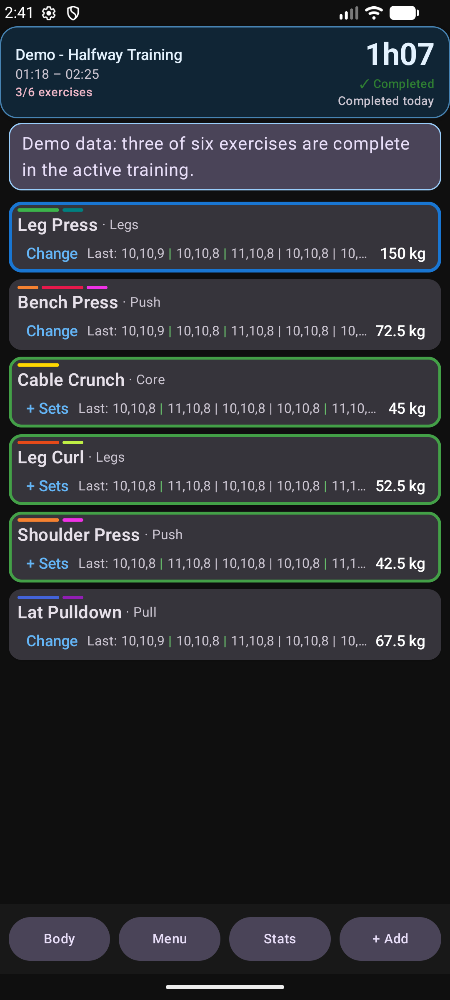
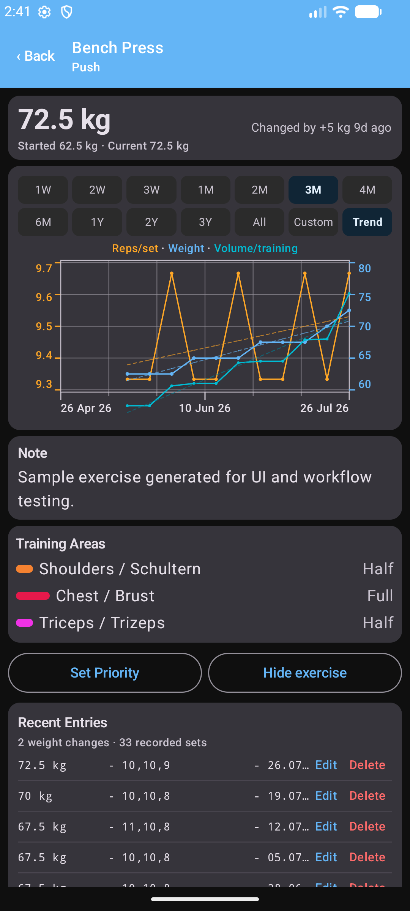
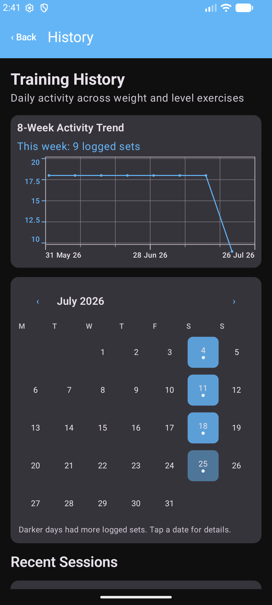
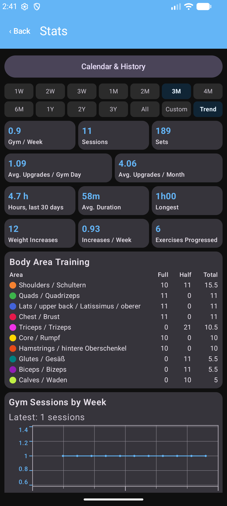

# GymLog

<p align="center">
  
</p>

<p align="center">
  An Android workout & weight tracker for logging, stats, plotting, and trends.
</p>

<p align="center">
  <a href="https://github.com/FlorianLindinger/GymLog/actions/workflows/verify.yml"></a>
  <a href="LICENSE"></a>
  
</p>

GymLog is built with Kotlin, Jetpack Compose, SQLite, and Health Connect. Workout data remains local by default; the app has no account system, analytics SDK, or internet permission.

## Features

- Convenient weight-, level-, and duration-based workout logging
- Multiple independent training plans
- Automatic, mixed pinned, and fully fixed exercise ordering
- Editable history, progression warnings, and live-training status
- Interval charts with gridlines, rolling averages, linear fits, and targets
- Body trends for weight, body fat, and lean body mass
- Optional, permission-controlled Health Connect import
- Local JSON export and restore

## Screenshots

| Overview | Exercise Details |
| --- | --- |
|  |  |

| History | Statistics |
| --- | --- |
|  |  |

Screenshots use sample data.

## Getting Started

Requirements:

- Android Studio and Android SDK 36
- JDK 17 or newer
- Android 8.0 (API 26) or newer device or emulator

Open the project in Android Studio, allow Gradle to sync, and run the `app` configuration. To build from PowerShell:

```powershell
scripts\windows\build.bat
```

The finished debug APK is published inside the Android project at `app\app\artifacts\debug\app-debug.apk`, where Google Drive can synchronize it. Disposable Gradle intermediates stay outside the repository to prevent cloud-sync file locks. Run the complete local verification with:

```powershell
scripts\windows\verify.bat
```

Windows development and release helpers are described in [scripts/windows](scripts/windows/README.md). GitHub Actions runs the same compile, lint, test, and APK checks on pushes and pull requests.

The [`google_drive_synced`](google_drive_synced/README.md) folder contains portable launchers for the debug and release output folders plus signed-release instructions.

## Demo Data

Open **Menu → Training Plans → Add Demo Training Plan** to create an isolated sample plan with ten weeks of history and a halfway-completed live workout. Repeating the action creates another uniquely named plan.

## Data and Privacy

Workout data is stored in the app's local SQLite database. Health Connect access is optional and controlled by Android permissions. JSON backups can be saved locally or through a document provider such as Google Drive.

Release signing is read only from `GYMLOG_KEYSTORE_FILE`, `GYMLOG_KEYSTORE_PASSWORD`, `GYMLOG_KEY_ALIAS`, and `GYMLOG_KEY_PASSWORD`. Never commit signing files or credentials.

## Project

```text
app/app/src/main/java/com/gymlog/app/
├── data/        SQLite repository and models
├── ui/          Compose screens and Health Connect integration
└── MainActivity.kt
docs/        Product documentation and screenshots
scripts/windows/ Development, device, and release helpers
```

- [ToDo-List](TODO.md)

## License

[MIT](LICENSE.txt)
